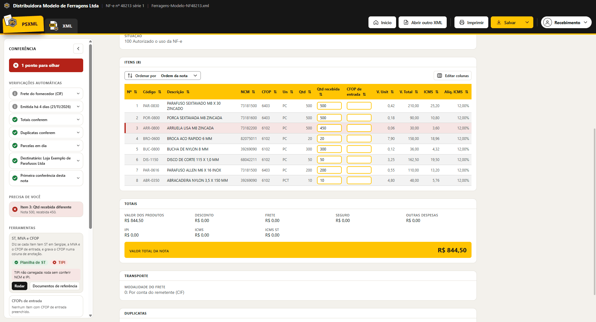
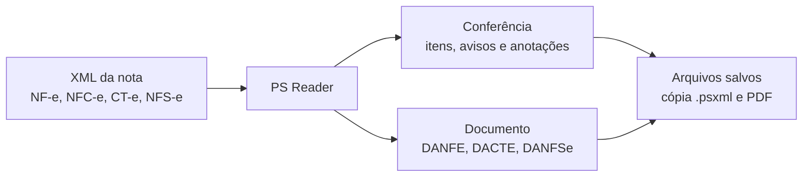
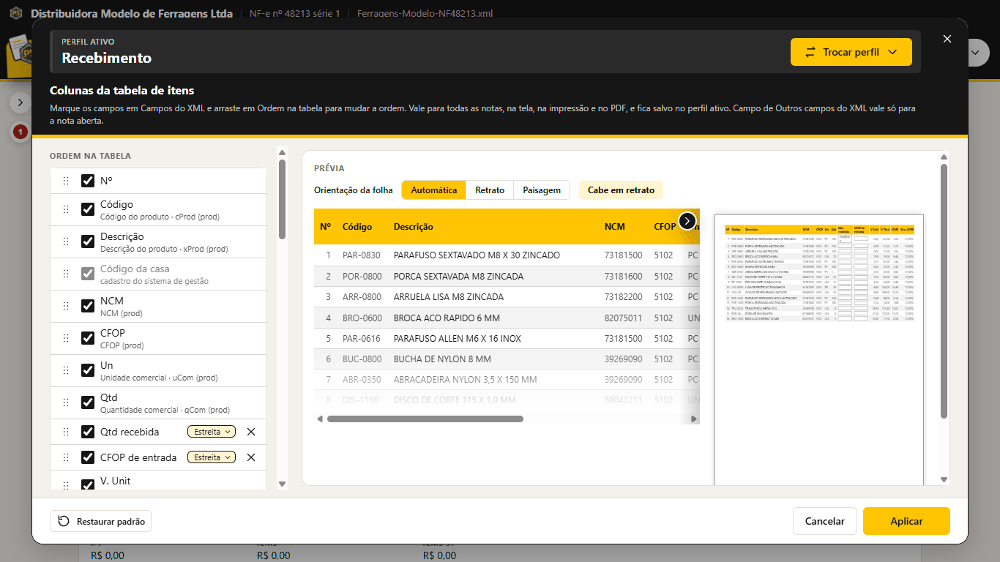
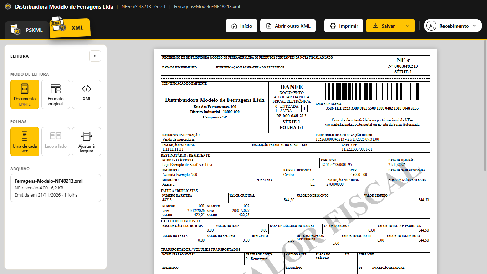
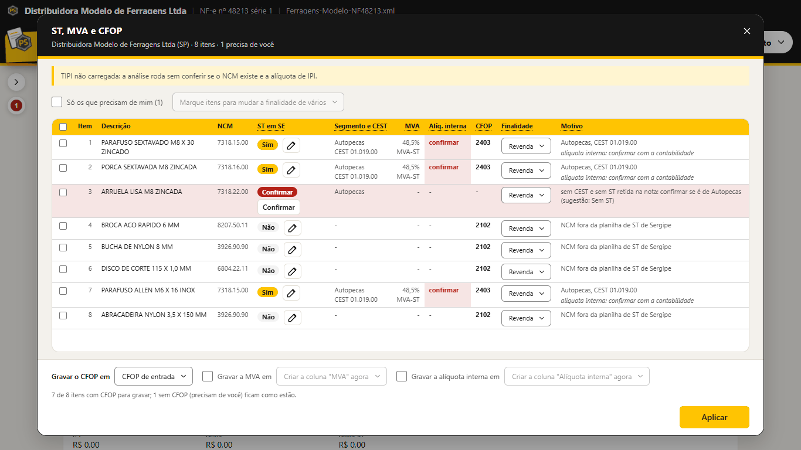
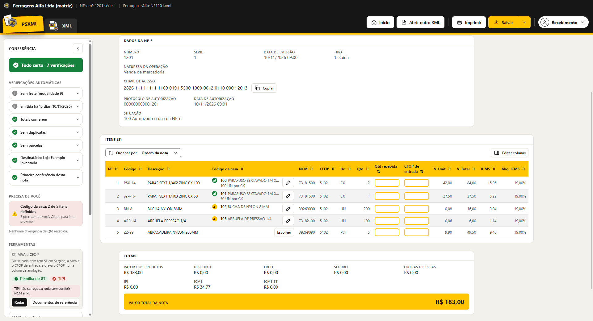
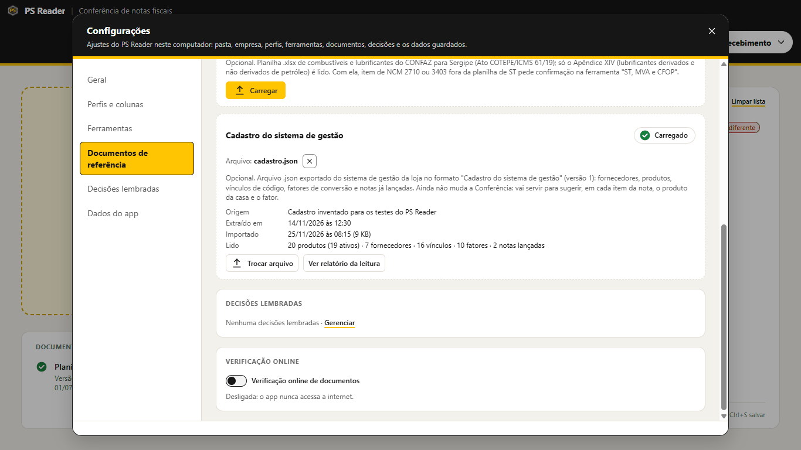
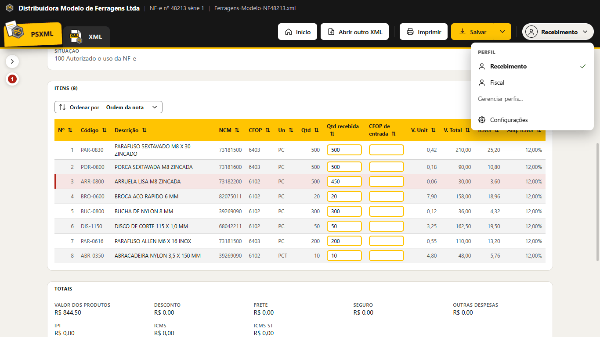

# PS Reader

**Abra o XML da NF-e, confira a nota item por item e salve a conferência,
tudo no seu computador, sem internet.**



O PS Reader é um aplicativo gratuito para Windows, feito para quem recebe
notas de fornecedores e confere antes de lançar no sistema de gestão. Ele lê
o XML, mostra a nota de um jeito fácil de conferir e aponta o que precisa de
atenção: quantidade recebida diferente, totais que não fecham, parcela
vencida, nota de outra empresa, nota que já foi conferida.



## O que ele faz

### Conferência da nota, do seu jeito

Os itens da nota numa tabela com as colunas que você escolhe: qualquer campo
de item da NF-e, na ordem e na largura que quiser, mais colunas para anotar
(Qtd recebida, CFOP de entrada, observação). A quantidade recebida diferente
da nota fica em vermelho, e o painel ao lado diz "Tudo certo" ou quantos
pontos olhar.



### DANFE e documentos fiscais fiéis ao XML

O DANFE sai em A4, como pede o manual da NF-e, só com o que está no XML,
também quando a nota foi emitida em contingência.
Também abre NFC-e, CT-e (DACTE), NFS-e Nacional e ABRASF (DANFSe) e eventos
(carta de correção, cancelamento). Imprima ou salve em PDF.



### ST, MVA e CFOP de entrada

Para cada item, a ferramenta diz se tem substituição tributária, a MVA e o
CFOP de entrada pela finalidade, com as evidências da nota, e grava o CFOP
numa coluna. Você confirma ou muda qualquer decisão, e o app lembra na
próxima nota do mesmo fornecedor. Usa a planilha de ST do CONFAZ e a TIPI,
que você carrega; hoje, com as regras de Sergipe.



### Produto da casa pelo cadastro

Importe o cadastro do seu sistema de gestão num formato aberto, em JSON ou
numa planilha CSV ([docs/formato-cadastro.md](docs/formato-cadastro.md)).
Com ele, a coluna **Código da casa** mostra em cada item da nota o produto da
loja e o fator ("12 UN por CX"), com um ícone de confiança. Você confirma ou
escolhe outro no quadro do item, o app lembra a escolha na próxima nota do
mesmo fornecedor, e o painel conta quantos itens ainda precisam de você.





### Perfis

Cada pessoa ou tarefa tem o seu perfil: colunas, anotações, folha do PDF,
ferramentas e onde a nota abre. Troque com um clique, exporte e importe
perfis e faça backup de tudo.



### Tudo no seu computador

Funciona offline. A nota não sai da máquina e o XML original nunca é
alterado: o que você anota fica numa cópia (`.psxml`). A única chamada de
rede é a verificação dos documentos de referência, que vem desligada.

## Como usar

1. Rode o instalador `PS Reader-<versão> Setup.exe` (gerado com
   `npm run make`). Ele instala só para o seu usuário, sem administrador, e
   abre o app. Windows 10 ou 11.
2. Na primeira vez, informe o CNPJ da loja: com ele, o app avisa quando a
   nota é de outra empresa.
3. Arraste o XML da nota para a janela ou clique em **Abrir arquivo**. No
   Explorer, o PS Reader também aparece no "Abrir com" do `.xml`.
4. Confira e anote. **Salvar** grava a cópia `.psxml` na pasta de destino, e
   a seta ao lado tem **Salvar PDF**.

O [manual](docs/manual.md) explica cada tela, os avisos e os formatos dos
arquivos.

## Para quem desenvolve

Electron e TypeScript, sem dependências além das do template do Electron
Forge.

```bash
npm install
npm start            # o app em desenvolvimento
npm run typecheck
npm run lint
npm test             # testes automáticos
npm run test:janela  # o app empacotado numa janela oculta, com notas inventadas
npm run make         # o instalador, em out\make\squirrel.windows\x64\
```

Antes de contribuir, leia o [CONTRIBUTING.md](CONTRIBUTING.md): o app é
genérico, sem nenhum sistema de gestão no código, e os testes usam só dados
inventados. O histórico das versões está no [CHANGELOG.md](CHANGELOG.md).
Licença MIT.

## In English

PS Reader is a free, offline Windows app for Brazilian stores that receive
NF-e electronic invoices. Open the invoice XML, check it item by item with
the columns you choose, get warned about received quantities, totals that
don't match, overdue installments or invoices addressed to another company,
and save your check as a PDF. It also renders the DANFE and other fiscal
documents (NFC-e, CT-e, NFS-e, events) exactly as in the XML, suggests ST,
MVA and entry CFOP for each item, matches each item to the store's own
product from an imported product catalog, and keeps per-user profiles. Nothing
leaves your computer. Built with Electron and TypeScript; MIT license.
